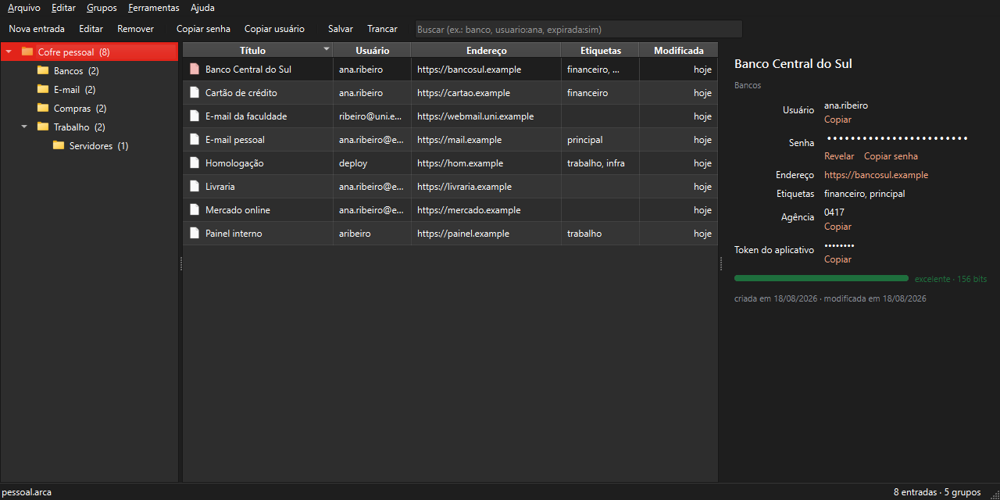
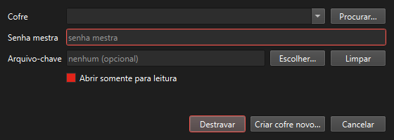

# Arca

Gerenciador de senhas local. O cofre é um único arquivo criptografado que fica
na sua máquina — não há sincronização, servidor, conta ou telemetria. O
programa nunca abre um socket.

O projeto foi escrito como trabalho de conclusão de curso, e por isso a
documentação explica não só o que o código faz, mas por que cada decisão foi
tomada. O formato de arquivo está especificado em
[docs/formato-do-arquivo.md](docs/formato-do-arquivo.md), a arquitetura em
[docs/arquitetura.md](docs/arquitetura.md), e os limites da proteção em
[docs/modelo-de-ameacas.md](docs/modelo-de-ameacas.md).



## O que ele faz

- Cofre em arquivo único (`.arca`), cifrado com AES-256 e autenticado por
  HMAC-SHA256 em blocos.
- Senha mestra derivada por Argon2id, com parâmetros calibráveis e gravados no
  próprio cofre.
- Organização em grupos aninhados, com lixeira.
- Gerador de senhas e de frases-senha, com entropia calculada por construção.
- Estimador de força que reconhece palavras de dicionário, sequências,
  repetições e senhas de vazamentos conhecidos.
- Busca com filtros (`usuario:ana url:gov.br`), que nunca pesquisa dentro de
  senhas.
- Limpeza temporizada da área de transferência.

## Instalação

Requer Python 3.11 ou superior.

```bash
git clone <repositório> arca
cd arca

python -m venv .venv
# Windows
.venv\Scripts\activate
# Linux e macOS
source .venv/bin/activate

pip install -e .
```

Para rodar os testes, use `pip install -e ".[dev]"`.

## Uso

```bash
arca                        # abre a tela de destravamento
arca pessoal.arca           # já aponta para um cofre
python -m arca              # equivalente, sem instalar o atalho
```



Na primeira execução, use **Criar cofre novo…** na tela de abertura. O botão
**Calibrar nesta máquina**, na seção de parâmetros criptográficos, ajusta as
iterações do Argon2id para uma derivação de cerca de 0,6 segundo no seu
hardware — vale a pena usá-lo.

| Atalho   | Ação                        |
|----------|-----------------------------|
| `Ctrl+N` | nova entrada                |
| `Ctrl+E` | editar entrada              |
| `Del`    | remover entrada             |
| `Ctrl+C` | copiar a senha              |
| `Ctrl+B` | copiar o usuário            |
| `Ctrl+U` | abrir o endereço            |
| `Ctrl+G` | novo grupo                  |
| `F2`     | renomear grupo              |
| `Ctrl+P` | gerador de senhas           |
| `Ctrl+S` | salvar                      |
| `Ctrl+L` | trancar o cofre             |

## Segurança em resumo

| Componente                | Escolha                                          |
|---------------------------|--------------------------------------------------|
| Derivação de chave        | Argon2id (64 MiB, 4 iterações, 4 threads)        |
| Cifragem                  | AES-256-CBC                                      |
| Autenticação              | HMAC-SHA256 por bloco, encrypt-then-MAC          |
| Senhas no payload         | mascaradas por keystream ChaCha20                |
| Aleatoriedade             | `secrets` e `os.urandom`, nunca `random`         |

Sal e IV são sorteados a cada gravação, o que troca a chave de cifragem a cada
salvamento. O cabeçalho, ainda que em texto claro, é autenticado: alterá-lo
para rebaixar o custo do Argon2id derruba a verificação.

**Não há recuperação.** Perder a senha mestra significa perder o conteúdo:
não há pergunta de segurança, e-mail de recuperação nem porta dos fundos. Faça
cópias de segurança do `.arca`.

## Estrutura

O código está organizado em MVC, com a criptografia isolada em uma camada
própria por ser o núcleo do trabalho:

```
arca/
├── src/arca/
│   ├── model/         os dados: cofre, grupos, entradas, arquivo, busca
│   ├── crypto/        a segurança: Argon2id, AES-256, HMAC, gerador
│   ├── controller/    a orquestração: sessão do cofre, ciclo da aplicação
│   ├── view/          a apresentação: janela, diálogos, widgets (PySide6)
│   └── resources/     listas de palavras
├── tests/
└── docs/
```

A dependência aponta sempre para dentro: `view` conhece `controller`, que
conhece `model`, que usa `crypto`. Nenhuma das camadas de baixo sabe que
existe uma interface. Veja [docs/arquitetura.md](docs/arquitetura.md).

## Desenvolvimento

```bash
pytest                      # suíte completa
pytest --cov=arca           # com cobertura
ruff check src tests        # análise estática
```

A suíte tem um arquivo por camada: `test_crypto.py`, `test_model.py`,
`test_storage.py` e `test_view.py`. Os testes de interface rodam com a
plataforma `offscreen` do Qt e não exigem sessão gráfica.

## Licença

MIT. Veja [LICENSE](LICENSE).
